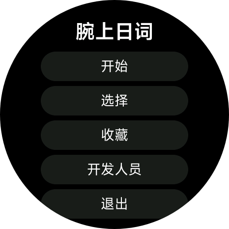

<div align="center">


# 腕上日词

**一个好用的日语记词软件**

[](LICENSE)
[](https://github.com/hapurenhl/wanshangrici)
[](https://iot.mi.com/vela/quickapp/)
[](#-词库)

[](https://skillicons.dev)

</div>

## 📖 简介

**腕上日词** 是一款运行在小米手表（Vela 快应用平台）上的日语单词学习应用。抬腕即背，把碎片时间变成词汇量。

- ▶️ **开始**：从上次进度继续，顺序背词，跨课自动衔接
- 📚 **选择**：按「单元 → 课 → 单词」自由学习
- ⭐ **收藏**：生词一键收藏，随时复习
- ⌚ **圆屏适配**：专为小米手表圆形表盘设计，字号自适应

## 📦 词库

> ⚠️ 目前仅收录 **《新版标准日本语·初级》** 单词

| 内容 | 数量 |
|---|---|
| 单元 | 12 个 |
| 课程 | 48 课 |
| 词卡 | 2213 张（含关联词、量词/接尾词独立卡） |

词卡包含：假名读音、汉字写法、词性、释义。后续版本将持续扩充词库。

## 📱 实机截图

<div align="center">

</div>

## 🛠️ 构建

```bash
npm install
npm run build     # 调试包
npm run release   # 发布包
```

构建工具：[aiot-toolkit](https://iot.mi.com/vela/quickapp/)（小米 Vela 快应用），产物为 `.rpk` 安装包，通过 AIoT-IDE 安装到手表。

## 💬 交流与反馈

[](https://qm.qq.com/)
[](mailto:hapuren@hapuren.cn)

- 交流群：**1130895633**
- 邮箱：**hapuren@hapuren.cn**

## 📄 许可证

本项目采用 [PolyForm Noncommercial 1.0.0](LICENSE) 许可证。

✅ 允许：个人学习、研究、非营利使用、修改与再分发
❌ 禁止：任何商业用途

## 赞助
- 爱发电：https://ifdian.net/a/hapuren
